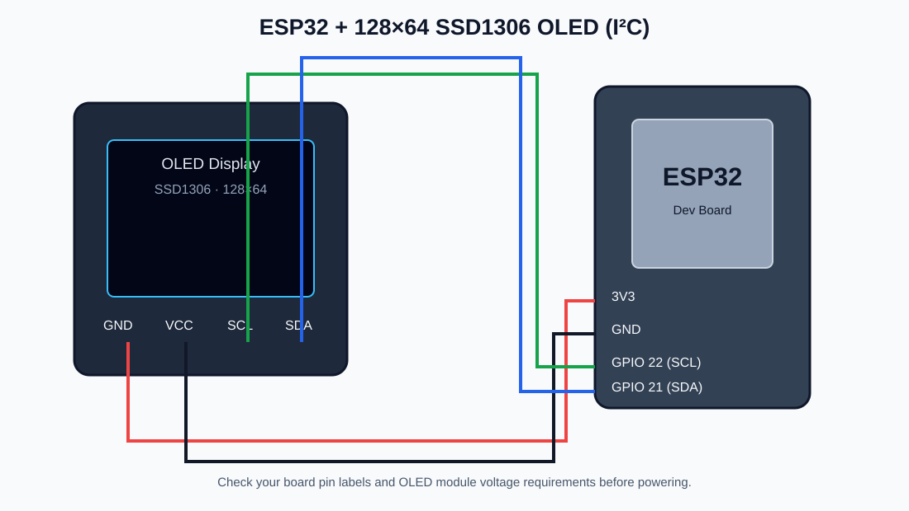

# Song Lyrics and Image Display System

An ESP32-based mini project that displays a sequence of monochrome bitmap scenes on a 128×64 SSD1306 I²C OLED display.

## Features
- Cycles through 12 pre-converted bitmap scenes.
- Changes scene every 5 seconds.
- Stores bitmap data in program memory (PROGMEM).

## Hardware
- ESP32 development board
- 128×64 SSD1306 I²C OLED display
- Jumper wires and USB power

## Circuit Diagram

## Wiring
| OLED pin | ESP32 connection |
|---|---|
| GND | GND |
| VCC | 3.3V / module-supported supply |
| SCL | GPIO 22 |
| SDA | GPIO 21 |

The sketch uses `Wire.begin(21, 22)` and OLED I²C address `0x3C`. Check the labels on your exact board and display module before connecting power.

## Software Requirements
- Arduino IDE with ESP32 board support
- Adafruit GFX Library
- Adafruit SSD1306 Library

## How It Works
1. The ESP32 initializes the I²C bus and OLED display.
2. The sketch stores 12 128×64 bitmap scenes in flash memory.
3. The first scene appears when the device starts.
4. The display advances to the next scene every 5 seconds, then repeats from the beginning.

## Uploading the Sketch
1. Open `song_lyrics_image_display.ino` in Arduino IDE.
2. Install the Adafruit GFX and Adafruit SSD1306 libraries.
3. Select the correct ESP32 board and port.
4. Upload the sketch and power the circuit.

## Files
- `song_lyrics_image_display.ino` — Arduino source code
- `circuit-diagram.svg` — circuit diagram

## Notes
- The scenes are stored as bitmap arrays inside the source code.
- Hardware operation has not been independently tested here; verify wiring and display voltage for your module.
- Before making this repository public, ensure you have permission to redistribute any copyrighted song lyrics or artwork included in the bitmap scenes.
